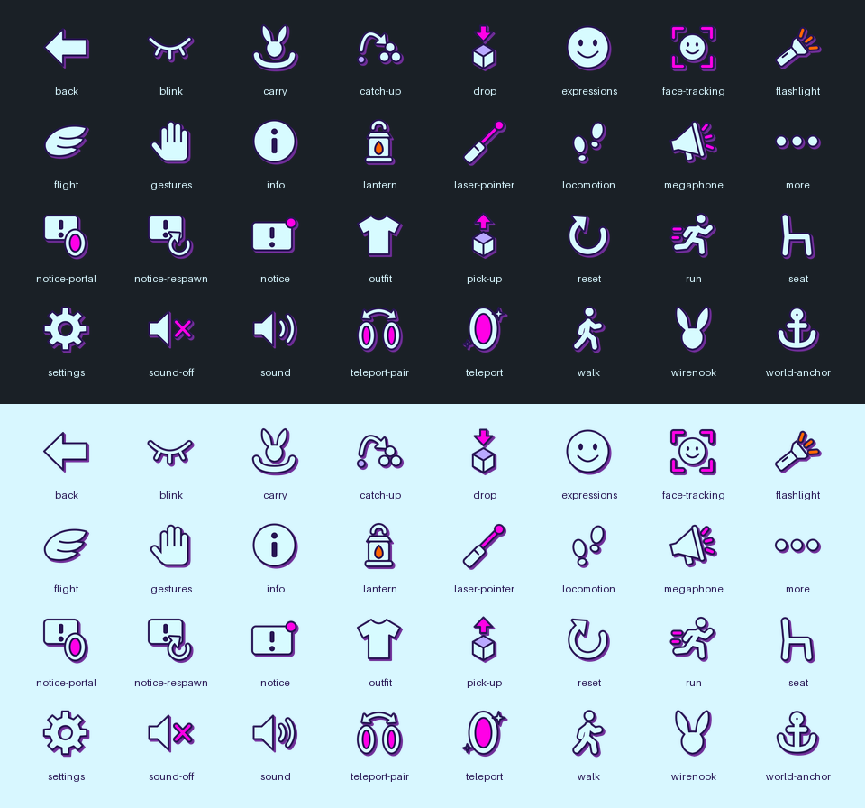

# Icons

Icons for VRChat's expression (radial) menu, drawn as one family.



## Files

- `<name>.svg` is the source; `<name>.png` beside it is the export Unity
  imports (256x256, RGBA, transparent). Source and export share a stem.
- Names are lowercase kebab-case and say what the control does, not what the
  picture shows: `catch-up`, not `arrow-to-dots`.
- `.contact-sheet.png` is generated. The leading dot hides it from Unity.

## Re-export

```bash
tools/icons.py           # export every SVG, redraw the contact sheet
tools/icons.py --check   # write nothing; exit 1 if anything is stale
```

Run from the repository root. Needs Inkscape 1.x on `PATH` (or `$INKSCAPE`)
and Pillow 10.1 or later. Unchanged icons are left untouched, so the diff after a run is
exactly what you edited. Never edit a PNG by hand.

## The system

The menu draws an icon at 64 to 100 px over a dark translucent wheel, so
every icon is a light sticker with a dark edge: the ice face carries it on
dark surfaces and the ink edge carries it on light ones. The hard violet
extrusion is the site banner's lettering treatment.

| Rule | Value |
| --- | --- |
| Canvas | 256x256, `viewBox="0 0 256 256"` |
| Clear space | the finished drawing, edge and extrusion included, stays 16 px inside the canvas (the exporter enforces this) and is centred on it |
| Extrusion | the whole drawing swept 8 px down-right in violet `#6d2c95`; faces are therefore composed around (122, 122), not (128, 128) |
| Edge | ink `#271452`, 8 px, round joins and round caps |
| Face | ice `#d7fbff` |
| Accents | magenta `#ff00e6` for whatever acts or emits (beams, arrows, portals, alerts); orange `#ff6600` for warm light; lavender `#b9a8ff` for a second surface |
| Corners | rectangles `rx` 8 to 16; everything else relies on the round joins |
| Lines | 12 px face (`limb`: 22 px) plus the 8 px edge on each side |

Stay inside `Textures/wirenook-palette.toml`. Cyan and banana are not used:
they disappear on the light surface.

The rules live in the `<style>` block every file carries. Draw with its
classes instead of inline colours:

- `body`, `soft`, `glow`, `warm`: a closed shape in ice, lavender, magenta or
  orange, with the edge centred on its outline.
- `edge` + `core`: an open line. Write the path twice, every `edge` first and
  every `core` after, so lines that meet fuse into one silhouette. Add `limb`
  to both for the heavier weight, and `soft`, `glow` or `warm` to the `core`
  to tint it.
- `edge solid` + `core solid`: a closed shape that has to fuse with lines (an
  arrowhead on a curve, a palm under fingers). Its path is the face's rim;
  the edge sits wholly outside it.
- `mark`, `dot`: ink detail drawn on top of a face (a mouth, an eye).

Everything sits inside the one `<g filter="url(#extrude)">`, which adds the
extrusion.

## Adding an icon

1. Copy the closest existing `.svg` to `<name>.svg` and change its `<title>`.
2. Replace the contents of the filtered group. Keep to the classes above;
   put points on whole pixels where the shape allows, ideally a 2 px grid.
3. Run `tools/icons.py`.
4. Open `.contact-sheet.png`. The icon must be recognisable at 64 px on both
   halves and sit at the same weight as its neighbours. If it only works on
   one, it leans on a colour instead of the face and edge.
5. Open the project in Unity so the new files get their `.meta`, and commit
   SVG, PNG, both metas and the contact sheet together.

`wirenook.svg` (and the rabbit in `carry.svg`) is the rabbit from the site's
triangle logo; see `CREDITS.md` at the repository root.
